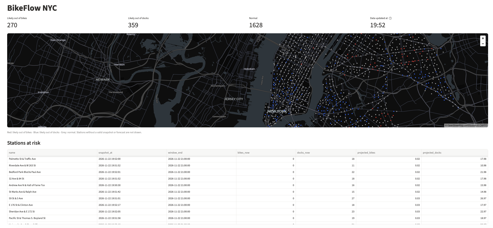
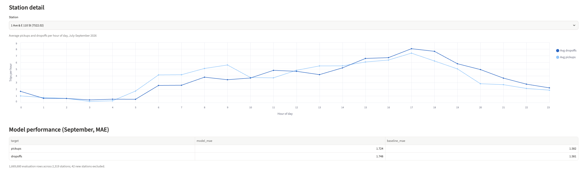

# BikeFlow NYC: Model and Dashboard sections (member C)

This file holds member C's README sections. B copies them into the main
README when assembling it: **Model** and **Dashboard** go in as top-level
sections, **Observability** and **Scalability** go under Undercurrents, and
the **Limitations** items join the shared Limitations section.

---

## Model

### What the model predicts

For every station and every hour, two numbers: how many bikes will be
**picked up** and how many will be **dropped off**. The risk view (below)
combines these with the live station status to flag stations that are likely
to run out of bikes or docks.

### Features (C1, `bikeflow/model/features.py`)

`build_features()` turns each (station, hour) row into 37 numeric features,
in a fixed order (`FEATURE_COLUMNS`):

| Features | Count | Meaning |
|---|---|---|
| `hour_0` … `hour_23` | 24 | Hour of day, one-hot |
| `dow_0` … `dow_6` | 7 | Day of week, one-hot (Monday = 0) |
| `is_holiday` | 1 | US federal holiday (`holidays.US()`); 7/3, 7/4 and 9/7 in our data |
| `temperature_c`, `precipitation_mm` | 2 | Hourly weather at one Manhattan point |
| `is_rain` | 1 | `precipitation_mm > 0` |
| `log_mean_pickups`, `log_mean_dropoffs` | 2 | `ln(station's training mean + 0.1)`: how busy the station usually is |

Stations without a training mean (new stations) are dropped instead of
predicted. Rows without weather are dropped, so the output never has nulls.

### Training and evaluation (C2, `bikeflow/model/train.py`, run with `make train`)

1. Read `fact_station_hour` joined with historical `weather_hour`
   (`is_forecast = false`) for July to September 2026. The read uses
   `COPY ... TO STDOUT` to move about 5 million rows quickly.
2. Time split: **train = July and August**, **test = September**.
3. Per-station training means are saved to `artifacts/station_means.parquet`.
4. Evaluation rows = September rows of stations that appear in training.
   42 stations that are new in September are excluded.
5. Two `PoissonRegressor(alpha=1e-4, max_iter=300)` models (pickups and
   dropoffs) are fit on a random 1,000,000-row sample of the training set
   (seed 42).
6. Baseline: the training mean for the same (station, hour of day,
   weekday or weekend).
7. Outputs: `poisson_pickups.joblib`, `poisson_dropoffs.joblib`,
   `metrics.json`, and the September predictions written to `forecast_hour`
   (`model_version = poisson_v1`), which A's SQL query 5 uses.

**Results (September, mean absolute error, trips per station-hour):**

| Target | Poisson model | Baseline |
|---|---|---|
| Pickups | 1.724 | **1.582** |
| Dropoffs | 1.748 | **1.581** |

Training rows: 1,000,000 · Evaluation rows: 1,669,680 · Stations evaluated: 2,319 · New stations excluded: 42

**The Poisson model is worse than the baseline, and we report it as is.**
The reason is the model's structure. In a Poisson regression the hour-of-day
effect is a single curve shared by all stations. Each station only gets one
"how busy" multiplier (`log_mean_*`). Real stations have very different
daily shapes: near homes, people take bikes out in the morning; near offices,
they bring them in. The baseline keeps a separate average for every station,
hour and weekday/weekend group, so each station effectively has its own
curve. The dashboard's station detail chart shows such a profile (see below).

We also ruled out non-convergence. scikit-learn warns that L-BFGS stops at
300 iterations. With `max_iter=2000` the fit converges after 602 iterations,
but pickups MAE only moves from 1.7236 to 1.7242, so the warning is not what
makes the model worse.

**Evaluation weather vs live weather:** the September evaluation uses
*observed historical* weather. Live predictions (C3) use the *forecast*
weather, which has its own errors, so live accuracy should be expected to be
somewhat lower than the numbers above.

### Live predictions (C3, `bikeflow/model/predict.py`)

`predict_next_hours(n_hours=24)` predicts every station that has a training
mean, for each hour from the **current hour** (now rounded down) onward. The
current hour is needed because the risk view uses it as H0. Weather comes from
`weather_hour` rows with `is_forecast = true`; hours without forecast weather
are skipped. Results are upserted into `forecast_hour`, so re-runs never
create duplicates. In Airflow, B's `forecast_hourly` DAG runs every hour at
minute 5: `fetch_weather_forecast` → `load_weather` → `predict_next_hours`, so
predictions always use the latest 48-hour forecast. A manual run is
`python -m bikeflow.model.predict`.

In a test run on 2026-11-22 at 19:30 it wrote 48,993 rows: 2,333 stations ×
21 hours (the forecast file reached 11/23 15:00). All predictions are ≥ 0,
because a Poisson model predicts a mean.

### Risk view (C4, `sql/views.sql`)

`v_station_risk` has one row per station and is the only thing the dashboard
reads for the map. For each station it:

1. takes the newest `station_status` row (largest `fetched_at`), and only
   **then** checks that it is valid: fetched within 30 minutes, reported
   within 60 minutes, and both renting and returning. If the newest row is
   stale, the station becomes `no_data`; it does not fall back to an older row;
2. sets the forecast window from the snapshot time to the end of the next
   full hour: H0 = snapshot hour, H1 = H0 + 1 h, `window_end` = H1 + 1 h,
   and `r` = share of H0 still left (a 14:20 snapshot gives r = 2/3);
3. computes `exp_pickups = r × pred(H0) + pred(H1)` (same for dropoffs),
   `projected_bikes = bikes_now − exp_pickups + exp_dropoffs` and
   `projected_docks = docks_now + exp_pickups − exp_dropoffs`;
4. labels the station: `no_data` (no valid snapshot or a missing H0/H1
   forecast) → `empty_risk` (projected bikes ≤ 2) → `full_risk` (projected
   docks ≤ 2) → `ok`.

`tests/test_risk_view.py` checks all of this against Postgres: the seven
required station cases, r = 2/3 for a snapshot at minute 20, and `window_end`
for snapshots at :55 and :05. Test times are built relative to the database's
`LOCALTIMESTAMP`, because the view's notion of "now" cannot be frozen.

---

## Dashboard

`dashboard/app.py` is a Streamlit app at **http://localhost:8501** (the
`dashboard` service in `compose.yaml`). From top to bottom it has six parts:

1. **Title**: BikeFlow NYC.
2. **Four metrics**: stations likely out of bikes, likely out of docks, normal,
   and *data updated at*, the newest snapshot time of any station. Hover the
   `?` for the full date.
3. **Map** (pydeck `ScatterplotLayer`, 40 m dots): red = likely out of bikes,
   blue = likely out of docks, grey = normal. `no_data` stations are not
   drawn. Hovering a dot shows that station's own snapshot time, window end,
   bikes and docks now, and projected bikes and docks. Stations report at
   different times, so each forecast window is shown per station rather than
   for the whole map.
4. **Stations at risk**: every red or blue station with the same columns as
   the hover box, sorted by projected bikes (emptiest first).
5. **Station detail**: pick a station to see its average pickups and dropoffs
   for each hour of day, July to September (24 points from `fact_station_hour`).
   The chart has fixed axes, so scrolling the page cannot zoom it.
6. **Model performance**: model vs baseline MAE read from
   `artifacts/metrics.json`.

All database reads are cached with `st.cache_data(ttl=60)`, so the page
re-queries at most once a minute however many people have it open.

In the station detail above (1 Ave & E 110 St), pickups exceed dropoffs from
6 to 9 a.m. and dropoffs exceed pickups from 4 to 7 p.m. This per-station
pattern is what the baseline captures and the shared-curve Poisson model
does not.

---

## Undercurrents: Observability (C)

- **Model quality is recorded, not just printed.** Every `make train` writes
  `artifacts/metrics.json` (model and baseline MAE, row and station counts,
  excluded new stations), and the dashboard shows it. A retrain that makes
  things worse is visible right away.
- **Data freshness is on the page.** The *data updated at* metric shows the
  newest snapshot time. The view only uses snapshots fetched in the last
  30 minutes. If GBFS collection stops, the counts move into `no_data`, red
  and blue dots disappear, and the update time stops moving, instead of the
  page showing old data as current.
- **Every prediction row is traceable.** `forecast_hour` stores
  `model_version` and `created_at`, so each prediction can be tied to the
  model that made it and the run time. `predict_next_hours()` returns the
  number of rows written, which shows up in the Airflow task log.
- **The risk view explains itself.** Besides `risk_level` it exposes the
  inputs (`snapshot_at`, `bikes_now`, `exp_pickups`, …), so any red or blue
  dot can be checked by hand from the hover box or the table.
- **Tests pin the expected behavior.** `test_risk_view.py`, `test_features.py`
  and `test_predict.py` run in CI on every pull request.

## Undercurrents: Scalability (C)

- **Bulk I/O instead of row-by-row.** Training reads about 5 million rows with
  `COPY ... TO STDOUT` into polars, and predictions are written with `COPY`
  into a temp table plus one `INSERT ... ON CONFLICT` (200,000-row batches).
  The full train-evaluate-write run (1.67 million prediction rows) takes about
  70 seconds on a laptop.
- **Bounded training cost.** Models are fit on a fixed 1,000,000-row sample,
  so training time does not grow with more history.
- **Vectorized features.** `build_features()` is pure polars expressions
  (5.09 million rows in about 4 seconds); there are no Python loops over rows.
- **Risk is computed in SQL, close to the data.** The view joins on primary
  keys and only touches the newest snapshot per station, so the dashboard
  loads one small table (one row per station, about 2,400) instead of raw
  history.
- **Caching at the edge.** `st.cache_data(ttl=60)` keeps database load flat as
  dashboard viewers increase.
- **What we would change at a larger scale:** partition `forecast_hour` by
  time and drop old live forecasts; make `v_station_risk` a materialized view
  refreshed after each prediction run; train per-station or clustered models
  in parallel; move history to columnar storage. These are left out on
  purpose to keep the course scope (spec section 1).

---

## Limitations (C's part)

- **The Poisson model is less accurate than the simple baseline**
  (MAE 1.72 vs 1.58 for pickups). See *Model* for why. Adding station × hour
  interaction features or per-station models would be the next step.
- **Risk is estimated only at the end of the window.** A station that briefly
  empties in the middle of the window and refills before `window_end` is not
  flagged.
- **First-start gap.** If a station's newest snapshot is in the previous hour
  (for example 14:55 seen at 15:05), it needs the 14:00 forecast. The first
  prediction run only starts at 15:00, so that station shows `no_data` until
  `forecast_hourly` has run once.
- **Projected bikes can be negative.** The formula does not clip at 0. A
  negative value means expected demand exceeds the bikes on hand, and the
  station is flagged as likely empty.
- **Live predictions depend on the weather forecast.** They only cover hours
  in the latest 48-hour forecast (F4). `forecast_hourly` refreshes it every
  hour, but if that DAG stops, predictions run out after at most 48 hours and
  stations turn `no_data`. Weather is a single Manhattan point for the whole
  city.
- **New stations are not predicted** until they have training history.
- **Evaluation uses historical weather, live use uses forecasts**, so the
  September MAE is an optimistic estimate of live accuracy.
- **Few holidays in the data.** July to September only has 7/3, 7/4 and 9/7,
  so the holiday effect is learned from very few days.

---

## AI use (C)

C's code (features, training, predictions, risk view, dashboard and their
tests) and this text were written with help from Claude, an AI assistant.
C reviewed all of it, ran it against the real data, and can explain each part.
Each of C's pull requests says this in its description.
