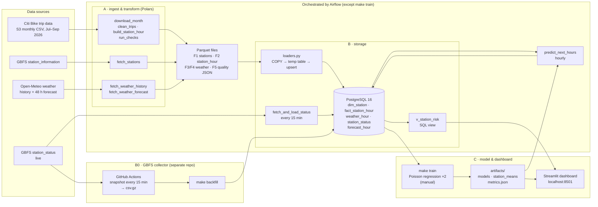
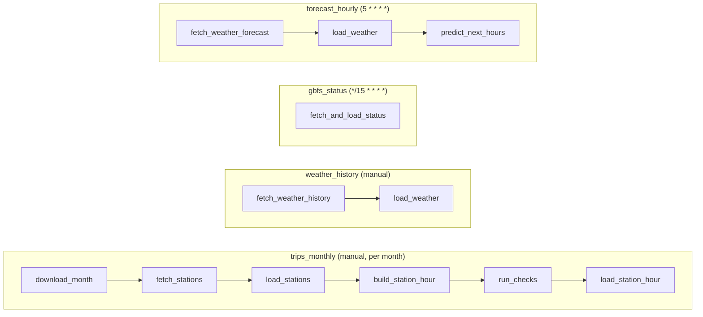
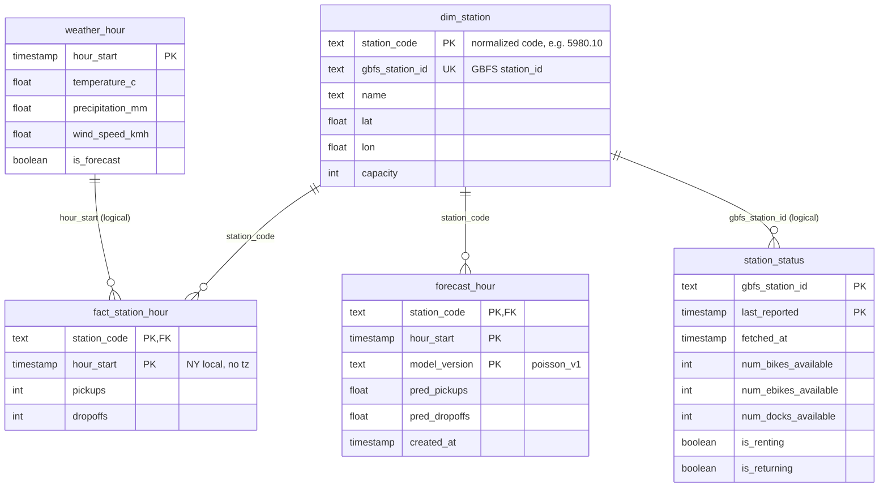
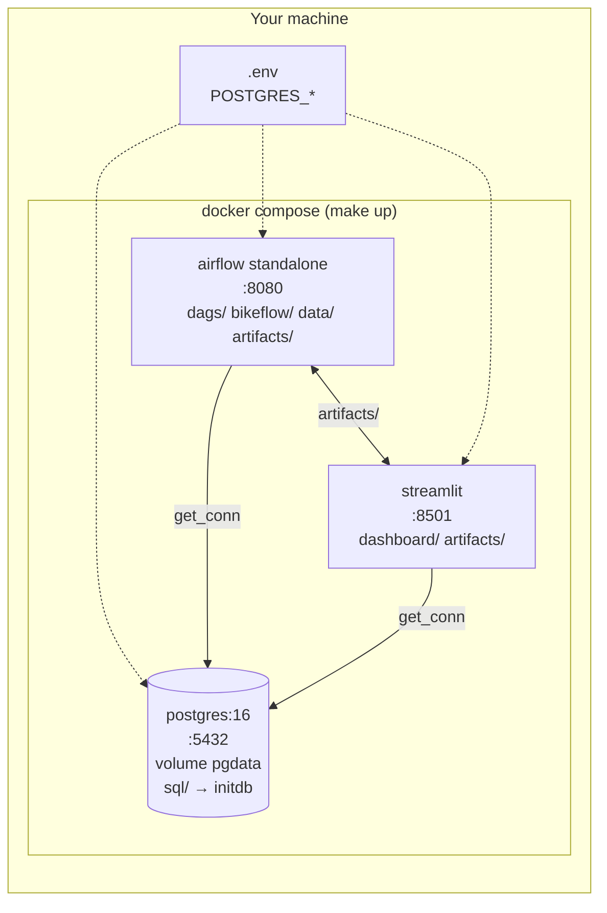
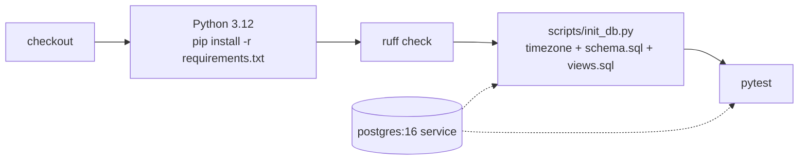

# BikeFlow NYC — Architecture

BikeFlow NYC turns four public data sources into an hourly "will this Citi Bike
station run out of bikes or docks?" map. The pipeline is split into three
stages with fixed contracts between them:

- **A — ingest & transform**: raw sources → cleaned Parquet files (F1–F5), with Polars
- **B — storage & orchestration**: files + live status → PostgreSQL, scheduled by Airflow, all in Docker
- **C — model & dashboard**: Poisson models write forecasts back to Postgres; a SQL view computes risk; Streamlit shows it

Each stage only talks to the next through files (section 3) or tables (section 4), so any
stage can be rewritten without touching the others.

## 1. Data flow

**Why this shape**

- **Files between A and B.** A's output is plain Parquet on disk, so A can be developed and
  tested with no database, and every load is reproducible from the files.
- **The database is the only shared state for C.** C reads history and writes forecasts through
  `bikeflow.db.get_conn()`; the dashboard reads one view, so risk logic lives in SQL, in one place.
- **Two paths for live status.** The Airflow DAG collects while the stack is running; the B0
  collector keeps collecting in GitHub Actions even when nobody's laptop is on, and
  `make backfill` loads that history.

## 2. Orchestration (Airflow)

All four DAGs only call functions from `bikeflow/`; there is no business logic in `dags/`.
Each task returns a file path that the next task reads from XCom.

| DAG | Schedule | Tasks |
|---|---|---|
| `trips_monthly` | manual, param `month` (e.g. `2026-09`) | download_month → fetch_stations → load_stations → build_station_hour → run_checks → load_station_hour |
| `weather_history` | manual | fetch_weather_history → load_weather(is_forecast=False) |
| `gbfs_status` | every 15 min | fetch_and_load_status |
| `forecast_hourly` | minute 5 of every hour | fetch_weather_forecast → load_weather(is_forecast=True) → predict_next_hours |

- `run_checks` raises if a quality check fails, so a bad month turns the DAG red **before**
  `load_station_hour` writes anything.
- Schedules use America/New_York time; `catchup=False` and `max_active_runs=1` on every DAG.
- Model training (`make train`) is deliberately **not** in Airflow: it runs once on July–August
  history, and its artifacts are reused by every hourly prediction.

## 3. File contracts (A → B, C)

All paths are relative to the repo root; `data/` and `artifacts/` are not committed.

| File | Path | Written by | Read by |
|---|---|---|---|
| F1 | `data/processed/stations.parquet` | A2 `fetch_stations` | B3 → `dim_station` |
| F2 | `data/processed/station_hour/station_hour_YYYYMM.parquet` | A4 `build_station_hour` | B3 → `fact_station_hour` |
| F3 | `data/processed/weather/weather_history.parquet` | A6 `fetch_weather_history` | B3 → `weather_hour` |
| F4 | `data/processed/weather/weather_forecast.parquet` | A6 `fetch_weather_forecast` | B3 → `weather_hour` |
| F5 | `data/processed/quality/quality_YYYYMM.json` | A5 `run_checks` | people / README |
| — | `artifacts/` (models, `station_means.parquet`, `metrics.json`) | C2 `train` | C3, dashboard |

## 4. Database (ERD)

| Table | Grain | Loaded by | Upsert key |
|---|---|---|---|
| `dim_station` | one row per station | B3 `load_stations` (F1) | `station_code` |
| `fact_station_hour` | station × hour, full grid (0 when no rides) | B3 `load_station_hour` (F2) | `(station_code, hour_start)` |
| `weather_hour` | one row per hour | B3 `load_weather` (F3/F4) | `hour_start` |
| `station_status` | one GBFS report per station | B4 `fetch_and_load_status`, `make backfill` | `(gbfs_station_id, last_reported)`; only `fetched_at` is updated on conflict |
| `forecast_hour` | station × hour × model | C2 `train`, C3 `predict_next_hours` | `(station_code, hour_start, model_version)` |

**Design notes**

- **Star-like layout.** `dim_station` is the dimension; the hourly facts and forecasts reference it
  with foreign keys, so a forecast can never point at an unknown station.
- **Two station keys.** Trip data uses short codes (`5980.10`), live GBFS uses `station_id`.
  `dim_station` stores both, which is the bridge between historical and live data.
  `station_status` has no foreign key on purpose: GBFS can report stations we dropped
  (e.g. Jersey City), and we still want to keep the raw feed.
- **All times are New York local time without a time zone**; conversion from UTC happens once,
  at ingest. The database timezone is also America/New_York, so `LOCALTIMESTAMP` in the view
  means "now in New York".
- **Every load is an upsert** (`COPY` into a temp table, then `INSERT … ON CONFLICT`), in one
  transaction, so re-running any task never duplicates rows and a failed load changes nothing.

**`v_station_risk` (view, C4)** — one row per `dim_station` station: takes each station's
newest valid snapshot from `station_status`, adds the expected pickups/dropoffs from
`forecast_hour` for the rest of the current hour and the next hour, and labels it
`empty_risk`, `full_risk`, `ok` or `no_data`. The dashboard reads only this view.

## 5. Deployment (Docker Compose)

| Service | Image | Port | Notes |
|---|---|---|---|
| `postgres` | `postgres:16` | 5432 | `sql/schema.sql` then `sql/views.sql` run on an empty volume; timezone America/New_York |
| `airflow` | `docker/airflow.Dockerfile` (apache/airflow 2.10.5 + `requirements.txt`) | 8080 | `airflow standalone`; code mounted, so edits need no rebuild |
| `dashboard` | `docker/app.Dockerfile` (python 3.12-slim + `requirements.txt`) | 8501 | `streamlit run dashboard/app.py` |

All three read the same `.env`; no credentials are in the code or the images. Dependency
versions are pinned in `requirements.txt`, so every machine and CI builds the same environment.

## 6. CI (GitHub Actions)

`.github/workflows/ci.yml` runs on every pull request and every push to `main`:

The test database is built from the same `schema.sql` and `views.sql` as Docker, so CI tests
the real schema, including the end-to-end integration test (A8) and the risk-view cases (C4).
DAG structure tests run where Airflow is installed and are skipped in CI.
